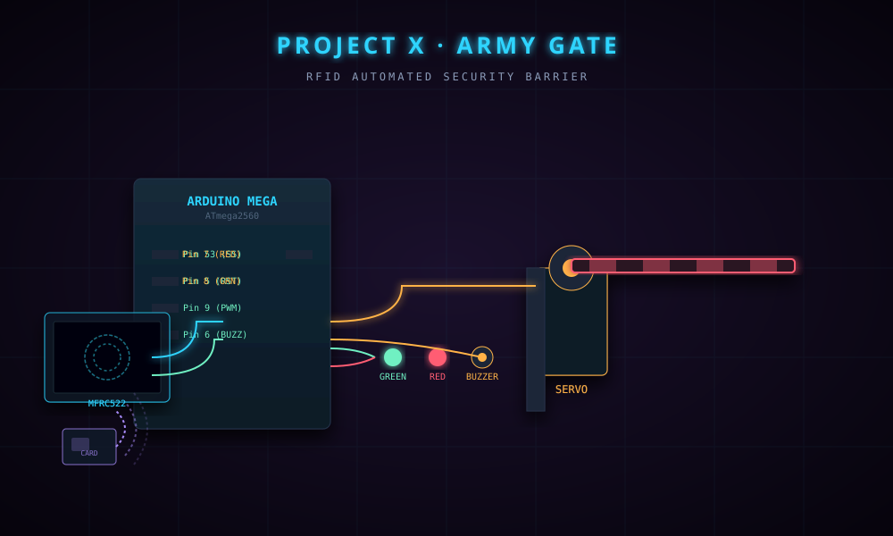

 <div align="center">



# 🚧 PROJECT X
## ARMY GATE

### `RFID AUTOMATED SECURITY BARRIER`

**SMART ACCESS CONTROL · ARDUINO MEGA · RFID · SERVO MOTOR**

<br/>


<br/><br/>

**Designed & Developed by Raja Sharma**

*An automated boom barrier system built with RFID authentication and servo mechanics.*

</div>

---

<div align="center">

## ◈ ABOUT THE PROJECT

*Intelligent Access Control · Embedded Systems · Automation*

</div>

**Project X · Army Gate** is an RFID-based automated access control prototype designed to demonstrate secure entry management using an Arduino Mega 2560.

The system uses an **MFRC522 RFID reader** to identify scanned cards and compare their UIDs against a predefined authorization list.

When an authorized card is detected, the servo motor opens the barrier, the Green LED indicates successful access, and the system automatically closes the gate after a configured delay.

For unauthorized cards, access is denied, the Red LED activates, and the buzzer provides an audible alert.

> **CORE OBJECTIVE**
>
> Demonstrate automated physical access control through RFID authentication, microcontroller-based decision-making and servo-driven barrier mechanics.

---

<div align="center">

## ◈ SYSTEM ARCHITECTURE & WORKFLOW

*From RFID scanning to access control*

</div>

```text
             ┌───────────────────┐
             │     RFID CARD     │
             │   13.56 MHz RF    │
             └─────────┬─────────┘
                       │
             ┌─────────▼─────────┐
             │   MFRC522 READER  │
             │    SPI INTERFACE  │
             └─────────┬─────────┘
                       │
             ┌─────────▼─────────┐
             │   ARDUINO MEGA    │
             │  UID VERIFICATION │
             └─────────┬─────────┘
                       │
                 ACCESS CHECK
                       │
              ┌────────┴────────┐
              │                │
       AUTHORIZED          UNAUTHORIZED
              │                │
       ┌──────▼──────┐  ┌──────▼──────┐
       │ SERVO OPENS │  │ BUZZER ON   │
       │ GREEN LED   │  │ RED LED     │
       └──────┬──────┘  └──────┬──────┘
              │                │
       GATE CLOSES        DENIED RESET
       AFTER 5 SECS       AFTER 1 SEC
```

---

<div align="center">

## ◈ KEY FEATURES

</div>

| FEATURE | DESCRIPTION |
|:---|:---|
| 🔐 **RFID Authentication** | Reads 13.56 MHz RFID tags and verifies authorized UIDs |
| ⚙️ **Servo-Controlled Gate** | Opens the barrier to 90° and closes automatically |
| 🚦 **Visual Feedback** | Green LED for granted access, Red LED for denied access |
| 🔔 **Audible Alert** | Buzzer indicates unauthorized access attempts |
| 🧠 **UID Verification** | Arduino Mega compares scanned card IDs against an authorized list |
| 🔄 **Automatic Reset** | Returns the system to its scanning state after each attempt |

---

<div align="center">

## ◈ HARDWARE CONFIGURATION

*Electronics · Components · Connectivity*

</div>

### Components Used

| COMPONENT | ROLE |
|:---|:---|
| Arduino Mega 2560 | Main Microcontroller |
| MFRC522 RFID Module | RFID Card / Tag Reader |
| SG90 / MG995 Servo | Gate Barrier Movement |
| Active Buzzer | Unauthorized Access Alert |
| Red LED | Access Denied Indicator |
| Green LED | Access Granted Indicator |
| Jumper Wires & Breadboard | Circuit Connections |

### GPIO Pin Mapping

| ARDUINO MEGA | COMPONENT | FUNCTION |
|:---:|:---|:---|
| Pin 53 | MFRC522 SS | SPI Slave Select |
| Pin 5 | MFRC522 RST | Reset Line |
| Pin 9 | Servo Motor | PWM Control |
| Pin 6 | Buzzer | Alarm Output |
| Pin 7 | Red LED | Denied Indicator |
| Pin 8 | Green LED | Granted Indicator |

<details>
<summary><b>⚡ Power & Wiring Configuration</b></summary>

**Important electrical considerations:**

- MFRC522 operates at 3.3V. Never connect its VCC directly to 5V.
- Use Arduino Mega SPI pins:
  - MISO: Pin 50
  - MOSI: Pin 51
  - SCK: Pin 52
- Use an appropriate external supply for servos that require more current than the board can provide.
- Connect the external supply ground to Arduino GND.
- Check the servo's voltage and current specifications before powering it.

</details>

---

<div align="center">

## ◈ GETTING STARTED

`01 CLONE` → `02 CONFIGURE` → `03 FLASH` → `04 TEST`

</div>

### 01 — Clone Repository

```bash
git clone https://github.com/luciferofx/projectxweb.git
```

### 02 — Navigate to Project

```bash
cd projectxweb/projects/projectx-army-gate
```

### 03 — Open Arduino Firmware

Open the following file in Arduino IDE:

```text
firmware/
└── armygate/
    └── armygate.ino
```

### Board Configuration

| SETTING | VALUE |
|:---|:---|
| Board | Arduino Mega or Mega 2560 |
| IDE | Arduino IDE |
| Language | Arduino C++ |
| Libraries | MFRC522, Servo |

Install the required libraries using Arduino IDE Library Manager.

### 04 — Configure Authorized RFID Cards

Open the `.ino` firmware and locate the authorized UID array:

```cpp
String authorizedUIDs[] = {
    "a3 80 ef f6",
    "8 d3 c4 3",
    "73 90 f2 2f"
};
```

Replace these example values with the actual UIDs of your RFID cards.

**How to identify a card UID:**

1. Upload the RFID reader firmware.
2. Open Arduino IDE Serial Monitor.
3. Set the baud rate to `9600` if that is what your firmware uses.
4. Scan an RFID card.
5. Copy its UID in the exact format printed by the firmware.

<details>
<summary><b>🔐 RFID Authentication Notes</b></summary>

The UID array is a basic demonstration-level authorization mechanism. RFID card UIDs alone are not strong cryptographic authentication and can be cloned or emulated. Do not use this prototype as the sole security mechanism for a real military or restricted-access facility.

</details>

### 05 — Run the Dashboard

The interactive web dashboard is available in:

```text
index.html
```

Open the file in your browser to explore the simulated dashboard interface, or deploy it using GitHub Pages.

**Note:** The HTML dashboard is a demonstration interface unless connected to a suitable hardware communication backend.

---

<div align="center">

## ◈ SOFTWARE ARCHITECTURE

</div>

| TECHNOLOGY | PURPOSE |
|:---|:---|
| Arduino C++ | Embedded control logic |
| Arduino Mega | Main processing unit |
| MFRC522 Library | RFID communication |
| Servo Library | Servo motor control |
| SPI | RFID reader communication |
| HTML5 | Dashboard structure |
| CSS3 | Dashboard styling |
| JavaScript | Dashboard interactions |

### Authentication Logic

```text
       RFID CARD SCANNED
                |
                ▼
       READ CARD UID
                |
                ▼
       COMPARE AUTHORIZED UID
                |
          ┌─────┴─────┐
          │           │
        MATCH       NO MATCH
          │           │
          ▼           ▼
      ACCESS       ACCESS
      GRANTED      DENIED
          │           │
      SERVO OPEN   RED LED ON
      GREEN LED    BUZZER ON
          │           │
      WAIT 5 SEC   WAIT 1 SEC
          │           │
      GATE CLOSE   RESET STATE
          │
          ▼
       READY FOR
       NEXT SCAN
```

---

<div align="center">

## ◈ TECHNOLOGY STACK


</div>

---

<div align="center">

## ◈ TROUBLESHOOTING

</div>

<details>
<summary><b>🔌 RFID Module Not Detecting Cards</b></summary>

- Check SPI wiring.
- Verify MFRC522 VCC is connected to 3.3V.
- Check SS and RST pin connections.
- Confirm the RFID library is installed.

</details>

<details>
<summary><b>⚙️ Servo Motor Jittering</b></summary>

- Check the servo power supply.
- Verify signal wiring.
- Use a suitable external power supply if required.
- Ensure a common ground.

</details>

<details>
<summary><b>🚫 Access Denied on an Authorized Card</b></summary>

- Open Serial Monitor.
- Scan the RFID card.
- Copy the exact UID.
- Check the UID formatting in `authorizedUIDs[]`.

</details>

<details>
<summary><b>🔔 Buzzer or LEDs Not Working</b></summary>

- Verify the assigned GPIO pins.
- Check LED polarity and resistors.
- Verify buzzer type and operating voltage.
- Inspect wiring connections.

</details>

---

<div align="center">

## ◈ PROJECT INFORMATION

| DETAIL | INFORMATION |
|:---|:---|
| Project | Project X · Army Gate |
| Category | Security / Automation |
| Controller | Arduino Mega 2560 |
| RFID Module | MFRC522 |
| Actuator | Servo Motor |
| Interface | Web Dashboard (Simulated) |
| Developer | Raja Sharma |
| Year | 2024 |
| License | MIT |

<br/>

<a href="https://github.com/luciferofx/projectxweb">

</a>

<a href="https://github.com/luciferofx">

</a>

<br/><br/>

### ⚡ SECURE THE PERIMETER. CODE THE FUTURE.

*Experiment. Engineer. Innovate.*

**© 2024 Raja Sharma · Project X Ecosystem**

</div>
