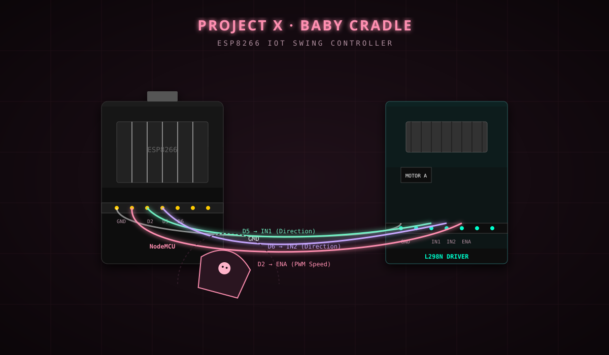

 <div align="center">

# 🍼 Project X · Baby Cradle

<p align="center">
  
</p>

<h2>IoT Automatic Cradle Swing System</h2>

### Smart Infant Monitor · ESP8266 Web Server

**Part of the [Project X Ecosystem](https://github.com/luciferofx/projectxweb)**

[](https://www.espressif.com/)
[](https://en.wikipedia.org/wiki/Internet_of_things)
[](LICENSE)
[]()

**Made by Raja Sharma · Project X Ecosystem**

</div>

---

## 📌 Overview

**Project X · Baby Cradle** is an IoT-based automatic cradle swing prototype powered by the ESP8266 NodeMCU.

The system creates its own local Wi-Fi Access Point (`Baby Cradle`), allowing users to access a web-based control dashboard directly from their smartphone without requiring an external Wi-Fi router or internet connection.

The project focuses on motor control automation, PWM-based speed adjustment, and an interactive dashboard featuring an animated cradle visualizer.

> **Project Goal:** Demonstrate an IoT-based automated cradle control prototype using ESP8266, motor drivers, and a responsive web interface.

---
## 🎥 Final Output — Dashboard + Cradle Swing

<div align="center">
  <video
    src="https://raw.githubusercontent.com/luciferofx/projectxweb/main/projects/projectx-baby-cradle/assets/images/final-output-of-babycradle.mp4"
    width="700"
    autoplay
    muted
    loop
    playsinline
    controls>
  </video>
</div>

## 🎥 Motor Working — Hardware Demo

<div align="center">
  <video
    src="https://raw.githubusercontent.com/luciferofx/projectxweb/main/projects/projectx-baby-cradle/assets/images/baby%20cradle%20motor%20work.mp4"
    width="700"
    autoplay
    muted
    loop
    playsinline
    controls>
  </video>
</div>

---
## ✨ Features

| Feature | Description |
|---|---|
| 📶 Standalone Wi-Fi AP | ESP8266 creates its own Wi-Fi network |
| 🎛️ PWM Speed Control | Adjustable motor speed using a 0–255 slider |
| 🎨 Animated Dashboard | Interactive SVG cradle swinging visualizer |
| ⚡ Start / Stop Control | Web-based motor control |
| 📱 Responsive Interface | Mobile-first dashboard design |
| 💾 State Memory | Saves the last selected speed using localStorage |
| 🌐 Offline Operation | Works through a local Wi-Fi connection |

---

## 🔌 Hardware Components

| Component | Purpose |
|---|---|
| ESP8266 NodeMCU | Main microcontroller |
| L298N Motor Driver | Motor control |
| DC Motor | Swing mechanism prototype |
| External Power Supply | Motor power |
| Jumper Wires | Hardware connections |
| Cradle Prototype Frame | Mechanical structure |

### Hardware Pin Mapping

| ESP8266 Pin | GPIO | L298N Pin | Function |
|---|---:|---|---|
| D2 | GPIO 4 | ENA | PWM Speed Control |
| D5 | GPIO 14 | IN1 | Direction Control |
| D6 | GPIO 12 | IN2 | Direction Control |
| GND | GND | GND | Common Ground |

**Power Configuration:** The ESP8266 and motor driver require an appropriate power arrangement. Follow the board and driver manufacturer's voltage specifications and ensure a common ground where required.

---

## 🚀 Quick Start

### 1. Clone the Repository

```bash
git clone https://github.com/luciferofx/projectxweb.git
```

### 2. Open the Project

Navigate to:

```bash
cd projectxweb/projects/projectx-baby-cradle
```

### 3. Flash the Firmware

1. Open Arduino IDE.
2. Open `firmware/babycradle/babycradle.ino`.
3. Select the board:

   **NodeMCU 1.0 (ESP-12E Module)**

4. Install the ESP8266 board package if required.
5. Connect your NodeMCU and upload the firmware.

### 4. Connect to Wi-Fi

After successful flashing, the ESP8266 creates a Wi-Fi network.

| Setting | Value |
|---|---|
| Network Name | `Baby Cradle` |
| Password | Open Network |
| Default IP | `192.168.4.1` |

Connect your smartphone or laptop to this network.

### 5. Open the Dashboard

Open your browser and visit:

**http://192.168.4.1**

The ESP8266 firmware serves the embedded HTML dashboard directly.

### 6. Control the Prototype

- Use the dashboard's Start/Stop controls.
- Adjust the motor speed using the PWM slider.
- Monitor the animated cradle visualizer.

---

## 🧠 Code Architecture

### Technologies & Libraries

- **C++** — Embedded firmware
- **ESP8266WiFi.h** — Wi-Fi Access Point
- **ESP8266WebServer.h** — HTTP server
- **HTML5 / CSS3 / JavaScript** — Web dashboard
- **SVG** — Animated cradle visualizer
- **PWM** — Motor speed control

### System Architecture

```text
          Smartphone / Laptop
                   |
                   | Wi-Fi
                   |
          ESP8266 Access Point
             192.168.4.1
                   |
             Web Dashboard
                   |
              HTTP Routes
                   |
             ESP8266 GPIO
                   |
              L298N Driver
                   |
                DC Motor
```

### API Routes

| Endpoint | Function |
|---|---|
| `/` | Serves the web dashboard |
| `/forward` | Starts motor operation |
| `/stop` | Stops motor operation |
| `/speed?value=XXX` | Updates PWM speed |

---

## 🖼️ Prototype & Hardware

<div align="center">


**Project X — Baby Cradle Hardware Prototype**

</div>

---

## 🛠️ Troubleshooting

| Problem | Possible Solution |
|---|---|
| Wi-Fi network not visible | Check ESP8266 power and firmware |
| Motor not spinning | Check motor driver connections and external power |
| Dashboard not opening | Connect to the Baby Cradle Wi-Fi network |
| Slider not changing speed | Check ENA connection and PWM configuration |
| ESP8266 keeps restarting | Verify power stability and wiring |

---

## ⚠️ Safety Notice

**This project is an educational electronics prototype, not a certified infant-care device.**

- Do not use the prototype with a real infant.
- Do not leave the motorized mechanism unattended.
- Keep electrical components and wiring secured.
- Independent mechanical safety systems and professional testing would be required before any real-world infant-care application.

---

## 📜 License

This project is licensed under the **MIT License**.

See [LICENSE](../../LICENSE) for details.

---

<div align="center">

### ⚡ Built with curiosity, electronics & code.

**[Raja Sharma](https://github.com/luciferofx)**

[GitHub](https://github.com/luciferofx) · [Project X Ecosystem](https://github.com/luciferofx/projectxweb)

*Project X · 2024*

</div>
