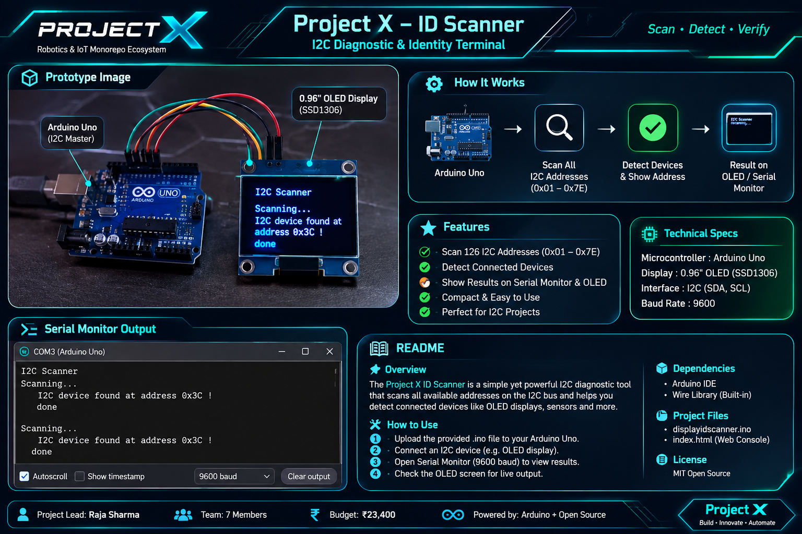
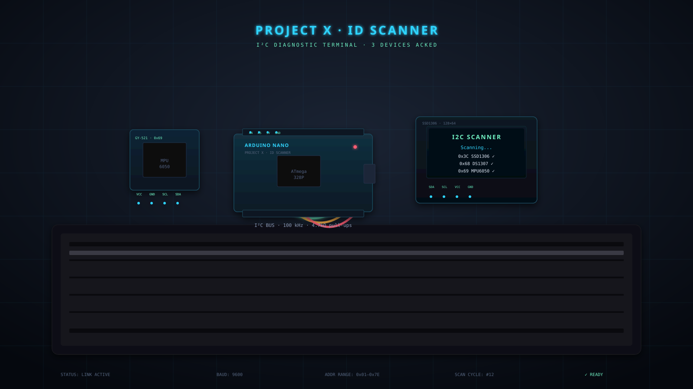

<div align="center">

# 🪪 Project X · ID Scanner

<p align="center">
  
</p>

<h2 align="center">I2C Diagnostic &amp; Device Identification System</h2>

### Digital ID &amp; Access Terminal · I2C Diagnostic Node

**Part of the [Project X Ecosystem](https://github.com/luciferofx/projectxweb)**

[](https://www.arduino.cc/)
[](https://en.wikipedia.org/wiki/I%C2%B2C)
[](https://github.com/luciferofx/projectxweb/blob/main/LICENSE)
[]()

</div>

---

## 📌 Overview

Jab hum complex robotics systems build karte hain jisme multiple I2C devices ek saath 2 wires (SDA & SCL) par judti hain, to hardware addresses clash ho sakte hain ya wrong pin configuration ki wajah se display blank rehta hai.

**Project X · ID Scanner** is a browser-based **I2C diagnostic terminal** paired with a lightweight **Arduino firmware** that continuously probes the I²C bus and reports every device it finds over serial. The web UI (WebSerial API) reads that serial stream live, plots the address map, logs telemetry, and can flash a compiled `.hex` back onto the ATmega328P — all without the Arduino IDE.

Yeh module microcontroller ke hardware I2C peripheral (`Wire.h`) ko initialize karke pure **7-bit hexadecimal address range (`0x01` se `0x7E`)** par handshake packets bhejta hai. Jab koi display ya sensor ACK (Acknowledge) signal return karta hai, tab serial console par exact address confirm ho jata hai.

It is the **4th node** in the Project X ecosystem and the "front door" — every other project (robot, army gate, cradle) plugs an I²C peripheral into this same bus scan, so this terminal doubles as your **bench-side sanity check**.

> **TL;DR** — Upload the `.ino`, open `index.html` in Chrome/Edge, connect the board, and every I²C peripheral on your desk lights up on a 128-cell address map in real time.

---

## ✨ Features

| | |
|---|---|
| 🔍 **Full bus sweep** | Probes `0x01 – 0x7E` (7-bit) with `Wire.endTransmission()` |
| 📡 **Live serial telemetry** | WebSerial stream → browser console, no IDE required |
| 🗺️ **128-cell address map** | Real-time ACK highlighting for every probed address |
| 🧠 **Known-device DB** | 25+ common sensors auto-labelled (SSD1306, MPU6050, BME280, …) |
| ⚡ **AVR flasher** | STK500v1 / optiboot — drop a `.hex`, flash the ATmega328P from the browser |
| 🧪 **Simulation mode** | Explore the entire UI with **zero hardware** |
| 📥 **Log export** | Download the full serial session as `.txt` |

---

## 📸 Prototype Schematic & Circuit Diagram

```
   [ ARDUINO UNO / NANO ]                             [ 0.96" I2C OLED DISPLAY ]
  +----------------------+                           +--------------------------+
  |                 5V   |-------------------------->| VCC                      |
  |                 GND  |-------------------------->| GND                      |
  |           A5 / SCL   |-------------------------->| SCL                      |
  |           A4 / SDA   |-------------------------->| SDA                      |
  |                 USB  |====> Serial Monitor       +--------------------------+
  +----------------------+      (@ 9600 Baud)
```

<div align="center">



*Arduino Nano + SSD1306 OLED + MPU6050 — three nodes ACKed on the bus*

</div>

**To regenerate the schematic photo:** open [`assets/images/scanner-display.svg`](assets/images/scanner-display.svg) in any browser, screenshot at 2× zoom, save as `ProjectXIDScanner.png`.

---

## 🧰 Hardware Requirements

| Component | Qty | Notes |
|---|---|---|
| Arduino Uno / Nano (ATmega328P) | 1 | Any AVR with hardware `Wire` works |
| SSD1306 OLED 128×64 (I²C) | 1 | Optional — for on-board display |
| I²C sensor(s) under test | 1+ | MPU6050, BME280, DS1307, … |
| 4.7 kΩ pull-ups on SDA/SCL | 2 | Most modules include these onboard |
| Breadboard + jumper wires | — | Common ground **mandatory** |

---

## 🔌 Hardware Pin Connections

| Device Pin | Arduino Uno / Nano | Arduino Mega | ESP8266 (NodeMCU) | Function |
| :--- | :--- | :--- | :--- | :--- |
| **VCC** | 5V / 3.3V | 5V | 3.3V / Vin | Power Bus |
| **GND** | GND | GND | GND | Common Ground |
| **SCL** | Pin A5 | Pin 21 (SCL) | Pin D1 (GPIO 5) | Serial Clock Line |
| **SDA** | Pin A4 | Pin 20 (SDA) | Pin D2 (GPIO 4) | Serial Data Line |

> ⚠️ **Common ground is not optional.** If the sensor module and the Arduino do not share a ground, the bus will randomly report phantom devices or fail with error `4`.

### SSD1306 OLED (optional local display)

| OLED Pin | Arduino Pin |
|:---:|:---:|
| `SDA` | `A4` |
| `SCL` | `A5` |
| `VCC` | `5V` |
| `GND` | `GND` |

---

## 🧠 Code Architecture (`displayidscanner.ino`)

- **Author:** Raja
- **Core Library:** `<Wire.h>`
- **Baud Rate:** `9600 Baud`
- **Address Range Scanned:** `1` to `126` (`0x01` to `0x7E`)

### Handshake Logic

```cpp
Wire.beginTransmission(address);
byte error = Wire.endTransmission();

if (error == 0) {
  // ACK received: Device actively responding!
} else if (error == 4) {
  // Line noise / Bus error detected
}
```

The web UI reads the firmware's serial output and maps every line to a visual action — see the table below.

---

## 🚀 Quick Start

### 1 · Flash the firmware

```bash
# Using arduino-cli
arduino-cli compile --fqbn arduino:avr:uno firmware/displayidscanner
arduino-cli upload  --fqbn arduino:avr:uno -p /dev/ttyUSB0 firmware/displayidscanner
```

Or open `firmware/displayidscanner/displayidscanner.ino` in the Arduino IDE and upload normally.

### 2 · Open the web terminal

```bash
# Any static server works
python3 -m http.server 8080
# → http://localhost:8080/projects/projectx-id-scanner/
```

> WebSerial requires a **secure context** — `localhost` counts, plain `http://` on a LAN IP does not. Use `https://` or `localhost`.

**Live demo (GitHub Pages):** [https://luciferofx.github.io/projectxweb/projects/projectx-id-scanner/](https://luciferofx.github.io/projectxweb/projects/projectx-id-scanner/)

### 3 · Connect

1. Click **`CONNECT HARDWARE`** → pick `/dev/ttyUSB0` (or `COM3`).
2. Baud rate must match the sketch: **`9600`**.
3. Press **`RUN BUS SCAN`** — or just wait 5 s, the sketch auto-scans.

### 4 · Manual setup (Arduino IDE)

1. Apne Arduino Uno / Nano ko USB cable ke through computer se connect karein.
2. Arduino IDE me file open karein:
   ```
   projects/projectx-id-scanner/firmware/displayidscanner/displayidscanner.ino
   ```
3. **Tools** menu se correct **Board** aur **COM Port** select karein.
4. **Upload** (`Ctrl + U`) button par click karein.
5. Upload complete hone ke baad **Serial Monitor** (`Ctrl + Shift + M`) open karein aur baud rate **9600** set karein.
6. Browser me interactive visualizer dekhne ke liye is folder ki `index.html` open karein.

---

## 🖥️ Expected Serial Monitor Output

Jab aapka 0.96" OLED display correctly wired hota hai, to Serial Monitor par ye output show hota hai:

```text
I2C Scanner
Scanning...
I2C device found at address 0x3C  !
done
```

On an unknown-bus error:

```text
Unknown error at address 0x22
```

And on an empty bus:

```text
No I2C devices found
```

### How the parser maps it

| Serial line | UI action |
|---|---|
| `Scanning...` | Clears the table, increments **Scan Cycles**, sets **Bus Status → SCANNING** |
| `I2C device found at address 0xNN  !` | Adds row to **Acknowledged Devices**, lights cell `NN` on the map |
| `Unknown error at address 0xNN` | Adds row with **UNKNOWN / NACK** tag |
| `done` | **Bus Status → READY**, stamps **Last Scan** time |
| `No I2C devices found` | Shows a warning toast in the console |

---

## 🧠 Known I²C Addresses

The firmware does **not** know device names — it only reports addresses. The web UI resolves them from this table:

| Address | Device | Description |
|:---:|:---:|:---|
| `0x08` | PCF8563 | Real-Time Clock |
| `0x1D` | ADXL345 | 3-Axis Accelerometer |
| `0x23` | BH1750 | Ambient Light Sensor |
| `0x27` | PCF8574 | LCD Backpack / I/O Expander |
| `0x3C` | SSD1306 | 128×64 OLED Display |
| `0x3D` | SSD1306 | 128×64 OLED (alt) |
| `0x40` | INA219 | Current / Power Monitor |
| `0x44` | SHT31 | Temp &amp; Humidity |
| `0x48` | ADS1115 | 16-bit ADC |
| `0x50` | AT24C32 | EEPROM 32 Kbit |
| `0x68` | DS1307 | Real-Time Clock |
| `0x69` | MPU6050 | 6-Axis Gyro / Accelerometer |
| `0x76` | BME280 | Temp / Pressure / Humidity |
| `0x77` | BMP180 | Barometric Pressure |

**Common device quick reference:**

| Address | Device |
|:---:|---|
| `0x3C` / `0x3D` | 0.96" SSD1306 Monochrome OLED Display |
| `0x27` / `0x3F` | 16×2 / 20×4 PCF8574 LCD |
| `0x68` | MPU6050 Accelerometer / Gyroscope Module |

> Full DB: 25 entries inside [`index.html`](index.html) under `KNOWN`.

---

## 🛠️ Troubleshooting

| Symptom | Likely cause | Fix |
|---|---|---|
| `No I2C devices found` | Sensor not powered, wrong SDA/SCL, missing GND | Check 5 V rail, swap SDA↔SCL, add common ground |
| Address `0x00` always appears | Short to GND on SDA/SCL | Inspect jumper wires |
| Two devices with same address | Address collision (common with EEPROMs) | Change A0/A1/A2 solder jumpers on one module |
| Serial shows garbled text | Baud mismatch | Sketch is `9600` — match it in the dropdown |
| `Unknown error at address 0xNN` | Bus contention, bad pull-up | Add 4.7 kΩ pull-ups on SDA & SCL to 5 V |
| WebSerial button greyed out | Not in Chrome/Edge, or `http://` non-localhost | Use Chrome ≥ 89 and serve via `localhost` or `https://` |

---

## 🧪 Testing Without Hardware

Click **`SIMULATION DEMO`** — the UI runs a virtual I²C bus, picks 2–5 random devices, and streams the *exact same* serial lines through the parser. Everything (address map, device table, console) behaves identically. Use this to validate UI changes before flashing a board.

**Live simulation:** [https://luciferofx.github.io/projectxweb/projects/projectx-id-scanner/](https://luciferofx.github.io/projectxweb/projects/projectx-id-scanner/)

---

## 🗂️ Folder Structure

```text
projectx-id-scanner/
├── README.md                              ← you are here
├── index.html                             ← standalone terminal UI
├── LICENSE                                ← MIT
├── assets/
│   └── images/
│       ├── ProjectXIDScanner.png          ← prototype photo
│       └── scanner-display.svg            ← editable source
└── firmware/
    └── displayidscanner/
        └── displayidscanner.ino           ← Arduino sketch
```

---

## 🔗 Part of the Project X Ecosystem

| Project | Description | Link |
|:---|:---|:---|
| 🤖 **Robot** | Autonomous AI robot (RPi + OpenCV + Arduino) | [`../projectx-robot/`](https://github.com/luciferofx/projectxweb/tree/main/projects/projectx-robot) |
| 🚧 **Army Gate** | Ultrasonic boom-barrier security gate | [`../projectx-army-gate/`](https://github.com/luciferofx/projectxweb/tree/main/projects/projectx-army-gate) |
| 🍼 **Baby Cradle** | ESP8266 IoT cradle swing | [`../projectx-baby-cradle/`](https://github.com/luciferofx/projectxweb/tree/main/projects/projectx-baby-cradle) |
| 🪪 **ID Scanner** | *This project* — I²C diagnostic &amp; flasher | [Project X · ID Scanner](https://github.com/luciferofx/projectxweb/tree/main/projects/projectx-id-scanner) |

---

## 📜 License

MIT — see [`LICENSE`](https://github.com/luciferofx/projectxweb/blob/main/LICENSE).

**Made with ⚡ by [Raja](https://github.com/luciferofx)** · *Project X, 2024*
