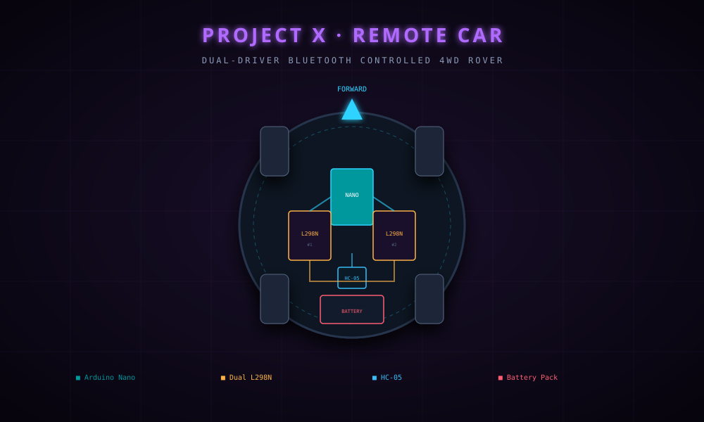

 <div align="center">



# 🤖 PROJECT X
## REMOTE CAR — 4WD ROVER

### `DUAL-DRIVER BLUETOOTH-CONTROLLED GROUND VEHICLE`

**ARDUINO NANO · HC-05 · DUAL L298N · 4WD SKID STEER**


**Designed & Developed by Raja Sharma**

*A 4-wheel-drive robotic platform with differential steering and wireless Bluetooth control.*

</div>

---

<div align="center">

## ◈ ABOUT THE PROJECT

</div>

**Project X · Remote Car** is a compact, battery-powered robotic ground vehicle designed for indoor traversal. Built around the Arduino Nano, it uses two L298N dual H-bridge motor drivers to control four DC gear motors.

The rover receives wireless commands through an HC-05 Bluetooth module and is operated using the **SriTu Hobby Android application**.

> **📱 REQUIRED ANDROID APPLICATION**
>
> Download SriTu Hobby to control the rover through Bluetooth.
>
> <a href="https://play.google.com/store/apps/details?id=com.srituhobby">
> 
> </a>

---

<div align="center">

## ◈ CIRCUIT DIAGRAM


*Complete circuit schematic featuring Arduino Nano, dual L298N motor drivers, HC-05 Bluetooth module, and four DC motors.*

</div>

---

<div align="center">

## ◈ KEY FEATURES

</div>

| FEATURE | DESCRIPTION |
|:---|:---|
| 📡 Wireless Control | HC-05 Bluetooth communication |
| ⚙️ Dual Motor Drivers | Two L298N modules controlling four motors |
| 🔄 Zero-Radius Turns | Differential steering for tight navigation |
| 🔋 Battery Powered | Rechargeable battery-powered platform |
| 📱 Android Control | SriTu Hobby mobile application |
| 🛞 4WD Platform | Four-wheel-drive robotic chassis |

---

<div align="center">

## ◈ HARDWARE CONFIGURATION

</div>

| COMPONENT | SPECIFICATION | QTY |
|:---|:---|:---:|
| Arduino Nano | ATmega328P, 5V, 16MHz | 1 |
| L298N Motor Driver | Dual H-Bridge Module | 2 |
| HC-05 Bluetooth | Serial Bluetooth Module | 1 |
| DC Gear Motor | 3V–6V BO-Type Motor | 4 |
| Wheels | 65mm Rubber Grip | 4 |
| Chassis | Circular Base Plate | 1 |
| Battery | 7.4V–11.1V Rechargeable Pack | 1 |

### GPIO Pin Mapping

| ARDUINO NANO | COMPONENT | FUNCTION |
|:---:|:---|:---|
| D0 (RX) | HC-05 TXD | Receives serial commands |
| D1 (TX) | HC-05 RXD | Bluetooth serial communication |
| D2 | L298N Inputs | Left motor direction |
| D3 | L298N Inputs | Left motor direction |
| D4 | L298N Inputs | Right motor direction |
| D5 | L298N Inputs | Right motor direction |
| 5V | HC-05 VCC | Bluetooth logic supply |
| GND | Common Ground | Shared system ground |

<details>
<summary><b>⚡ Power & Wiring Notes</b></summary>

- Verify battery voltage and current ratings against the motor and driver specifications.
- Use a suitable regulated supply for the Arduino and Bluetooth module.
- Connect all system grounds to a common ground.
- HC-05 RX uses 3.3V logic. Use an appropriate level shifter or voltage divider when connecting it to a 5V Arduino TX output.
- Verify the L298N onboard regulator ratings before using it to power other components.

</details>

---

<div align="center">

## ◈ CONTROL PROTOCOL

</div>

The rover uses single-character ASCII commands over Bluetooth serial communication at **9600 bps**.

| KEY | ACTION | LEFT MOTORS | RIGHT MOTORS |
|:---:|:---|:---|:---|
| `U` | Forward | HIGH, LOW | HIGH, LOW |
| `D` | Backward | LOW, HIGH | LOW, HIGH |
| `L` | Turn Left | HIGH, LOW | LOW, HIGH |
| `R` | Turn Right | LOW, HIGH | HIGH, LOW |
| `S` | Stop | LOW, LOW | LOW, LOW |

<caption>Command mapping must match the Arduino firmware and the SriTu Hobby app configuration.</caption>

---

<div align="center">

## ◈ GETTING STARTED

</div>

### 01 — Clone Repository

```bash
git clone https://github.com/luciferofx/projectxweb.git
```

### 02 — Navigate to Project

```bash
cd projectxweb/projects/projectx-remotecar
```

### 03 — Upload Arduino Firmware

Open the following file in Arduino IDE:

```text
firmware/
└── remotecar/
    └── remotecar.ino
```

| SETTING | VALUE |
|:---|:---|
| Board | Arduino Nano |
| Processor | ATmega328P |
| Port | Your connected COM / serial port |

Upload the firmware to the Arduino Nano.

### 04 — Install SriTu Hobby

Download the application from Google Play Store.

<div align="center">

<a href="https://play.google.com/store/apps/details?id=com.srituhobby">

</a>

</div>

### 05 — Bluetooth Pairing

1. Switch on the rover.
2. Enable Bluetooth on your Android smartphone.
3. Find the HC-05 module.
4. Pair with the module using its configured PIN, if requested.

### 06 — Control the Rover

1. Open the SriTu Hobby application.
2. Navigate to its Bluetooth Car Remote feature.
3. Connect to the HC-05 module.
4. Use the available joystick or on-screen controls.
5. Test the rover on a clear, flat surface.

---

<div align="center">

## ◈ SYSTEM ARCHITECTURE

</div>

```text
       ANDROID SMARTPHONE
       [ SriTu Hobby App ]
                |
         BLUETOOTH LINK
                |
          [ HC-05 MODULE ]
                |
           UART SERIAL
                |
         [ ARDUINO NANO ]
                |
          MOTOR CONTROL
                |
          +-----+-----+
          |           |
      [L298N #1]  [L298N #2]
          |           |
      LEFT MOTORS RIGHT MOTORS
          |           |
          +-----+-----+
                |
          [ 4WD CHASSIS ]
```

---

<div align="center">

## ◈ TROUBLESHOOTING

</div>

<details>
<summary><b>🔌 Bluetooth module not detected</b></summary>

- Check HC-05 power and ground connections.
- Confirm the module is in pairing mode.
- Check Bluetooth permissions on Android.
- Restart the app and reconnect.

</details>

<details>
<summary><b>⚙️ Wheels spinning in opposite directions</b></summary>

- Check motor polarity.
- Verify motor driver connections.
- Confirm the firmware direction mapping.

</details>

<details>
<summary><b>📡 Commands not responding</b></summary>

- Confirm the Bluetooth connection.
- Verify the serial baud rate.
- Check whether the app sends commands supported by the firmware.
- Inspect the RX/TX connections.

</details>

<details>
<summary><b>🔋 Rover resets under load</b></summary>

- Check battery condition and voltage stability.
- Verify the supply can handle the motor load.
- Use an appropriately rated regulated supply for the controller.

</details>

---

<div align="center">

## ◈ FUTURE ROADMAP

</div>

| VERSION | FEATURE |
|:---:|:---|
| v1.1 | PWM speed control through ENA/ENB |
| v2.0 | HC-SR04 ultrasonic obstacle detection |
| v2.1 | Battery voltage telemetry |
| v3.0 | Dedicated Android controller |
| v3.1 | Live telemetry dashboard |

---

<div align="center">

## ◈ PROJECT INFORMATION

</div>

| DETAIL | INFORMATION |
|:---|:---|
| Project | Project X · Remote Car |
| Category | Robotics / Embedded Systems |
| Controller | Arduino Nano (ATmega328P) |
| Motor Drivers | Dual L298N |
| Communication | Bluetooth (HC-05) |
| Mobile Application | SriTu Hobby |
| Developer | Raja Sharma |
| Year | 2024 |
| License | MIT |

---

<div align="center">

<a href="https://github.com/luciferofx/projectxweb">

</a>

<br/><br/>

### ⚡ DRIVE FORWARD. TURN ZERO. INNOVATE.

**© 2024 Raja Sharma · Project X Ecosystem**

</div>
