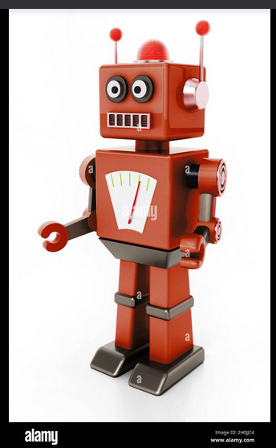

<!DOCTYPE html>
<html lang="en">
<head>
<!--
  ============================================================
  PROJECT X · INTELLIGENT ROBOT (PREMIUM SHOWCASE)
  File: index.html
  Version: 4.0.0 · Build 2024.12
  ============================================================
-->
<meta charset="UTF-8">
<meta name="viewport" content="width=device-width, initial-scale=1.0, viewport-fit=cover">
<meta name="theme-color" content="#05070d">
<meta name="description" content="Project X · Intelligent AI Robot Dashboard & Showcase">
<title>Project X — Intelligent Robot</title>
<link rel="preconnect" href="https://fonts.googleapis.com">
<link rel="preconnect" href="https://fonts.gstatic.com" crossorigin>
<link href="https://fonts.googleapis.com/css2?family=DM+Mono:wght@400;500&family=Manrope:wght@400;500;600;700;800&family=Orbitron:wght@600;700;800&display=swap" rel="stylesheet">
<!-- Global CSS -->
<link rel="stylesheet" href="../../styles.css">

</head>
<body>

  <!-- ===== TOPBAR ===== -->
  

    

      

        <b style="color: var(--violet); text-shadow: 0 0 10px var(--violet);">PX</b>
      

      

        <h1>PROJECT X · AI ROBOT</h1>
        
Intelligent Collaborative Effort

      

    

    

      
      SYSTEM ONLINE
    

  

  <!-- ===== HERO SECTION ===== -->
  <section class="premium-card" style="padding: 0; overflow: hidden; margin-bottom: 24px; border-color: var(--violet);">
    

      <!-- Fallback color if image is missing -->
      

        
      

      

        
FLAGSHIP PROJECT

        <h2 style="font-family: var(--disp); font-size: clamp(1.8rem, 5vw, 3rem); color: #fff; text-shadow: 0 4px 15px rgba(0,0,0,0.9); margin-bottom: 8px; line-height: 1.1; letter-spacing: 1px;">THE INTELLIGENT ROBOT</h2>
        
ARDUINO MEGA · OPENCV AI · MG995 SERVOS · HC-05

      

    

  </section>

  

    
    <!-- ===== MAIN COLUMN ===== -->
    

      
      <!-- FEATURES -->
      <section class="premium-card" style="padding: 24px;">
        <h3 style="color: #fff; font-size: 1.1rem; margin-bottom: 20px; display: flex; align-items: center; gap: 10px;">
           Project Functions
        </h3>
        

          
          

            
📱

            
Mobile / IP Control

            
The robot can be controlled remotely through a mobile app or IP interface.

          

          

            
😊

            
Facial Expressions

            
The robot can simulate various facial expressions using servo motors.

          

          

            
🗣️

            
Bluetooth & Speech

            
Connects via Bluetooth and is capable of speech using text-to-speech.

          

          

            
🤖

            
Autonomous Movement

            
The robot is capable of moving from one location to another autonomously.

          

        

      </section>

      <!-- AI VISION SIMULATOR -->
      <section class="premium-card" style="padding: 24px; margin-top: 20px;">
        <h3 style="color: #fff; font-size: 1.1rem; margin-bottom: 20px; display: flex; align-items: center; gap: 10px;">
           AI Vision Simulator
        </h3>
        
        

          

            
            <!-- Camera Feed -->
            

              

                

                

                  
RAJA

                

              

              

                 LIVE
              

            

            <!-- Detection Log -->
            

              
DETECTION LOG

              

                
[System] AI Model Loaded.

                
[System] Scanning for faces...

              

              <button class="primary" style="margin-top: 16px; width: 100%;" onclick="simulateAI()">▶ START RECOGNITION</button>
            

          

        

      </section>

      <!-- HARDWARE BLUEPRINTS -->
      <section class="premium-card" style="padding: 24px; margin-top: 20px;">
        <h3 style="color: #fff; font-size: 1.1rem; margin-bottom: 20px; display: flex; align-items: center; gap: 10px;">
           Hardware Blueprints
        </h3>
        
        

          <!-- Item 1 -->
          

            
            
Chassis Base

          

          

            
            
Servo Mount

          

          

            
            
Arm Joint

          

          

            
            
Head Bracket

          

          

            
            
Gear Assembly

          

          

            
            
Chest Panel

          

          

            
            
Wiring Layout

          

          

            
            
Motor Mounts

          

          

            
            
Full Frame

          

          

            
            
Sensor Mount

          

          

            
            
Back Plate

          

          

            
            
Battery Tray

          

          

            
            
Final Assembly

          

          

            
            
CAD Render

          

        

      </section>

    

    <!-- ===== SIDEBAR ===== -->
    

      
      <!-- TEAM MEMBERS -->
      <section class="premium-card" style="padding: 20px;">
        <h3 style="color: #fff; font-size: 1rem; margin-bottom: 16px; display: flex; align-items: center; gap: 8px;">
          👥 Team Effort
        </h3>
        

          

            Lead Dev
            RAJA
          

          
MemberAnshul Varsha

          
MemberPurushan

          
MemberAbhay

          
MemberHamdan

          
MemberShriyansh

        

      </section>

      <!-- DISPLAY VIDEOS -->
      <section class="premium-card" style="padding: 20px; margin-top: 20px;">
        <h3 style="color: #fff; font-size: 1rem; margin-bottom: 16px; display: flex; align-items: center; gap: 8px;">
          📺 Display Telemetry
        </h3>
        

          
          

            <video src="assets/images/display/display%20prototype.mp4" controls preload="metadata" style="width: 100%; display: block; aspect-ratio: 16/9; object-fit: cover;"></video>
            
DISPLAY PROTOTYPE

          

          

            <video src="assets/images/display/display%20result.mp4" controls preload="metadata" style="width: 100%; display: block; aspect-ratio: 16/9; object-fit: cover;"></video>
            
DISPLAY RESULT

          

        

      </section>

      <!-- CONTROL CONTROLS -->
      <section class="premium-card" style="padding: 20px; margin-top: 20px;">
        <h3 style="color: #fff; font-size: 1rem; margin-bottom: 16px; display: flex; align-items: center; gap: 8px;">
          🎮 Quick Controls
        </h3>
        

          

          <button class="primary" onclick="moveRobot('F')" style="padding: 12px 0;">▲</button>
          

          
          <button class="primary" onclick="moveRobot('L')" style="padding: 12px 0;">◀</button>
          <button class="danger" onclick="moveRobot('S')" style="padding: 12px 0; font-size: 0.7rem;">STOP</button>
          <button class="primary" onclick="moveRobot('R')" style="padding: 12px 0;">▶</button>
          
          

          <button class="primary" onclick="moveRobot('B')" style="padding: 12px 0;">▼</button>
          

        

      </section>

    

  

  <footer style="margin-top: 40px; border-top: 1px solid var(--line); padding-top: 20px;">
    PROJECT X · INTELLIGENT ROBOT
    BUILD 4.0.0 · PREMIUM EDITION
  </footer>

</body>
</html>
