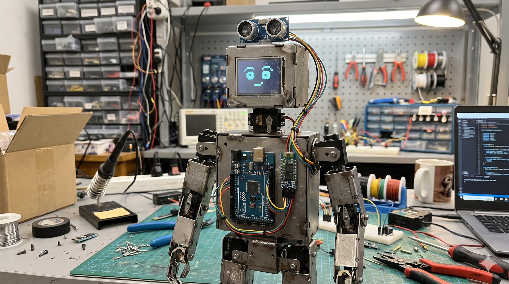
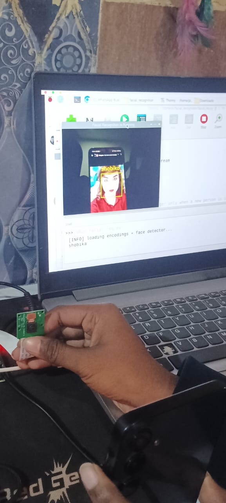

<div align="center">



# 🤖 PROJECT X
## AUTONOMOUS AI ROBOT

### `WI-FI CONTROLLED 4WD ROBOT WITH FACE RECOGNITION & LCD TELEMETRY`

**NODEMCU ESP8266 · PYTHON · OPENCV · L298N · I2C LCD**


### Designed & Developed by Raja Sharma

*An IoT-powered robotic platform combining wireless movement control, AI-based facial recognition, and real-time LCD telemetry.*

</div>

---

## ◈ ABOUT THE PROJECT

**Project X – Autonomous AI Robot** is an experimental robotics platform that integrates embedded systems, wireless communication, and computer vision.

The project is divided into three primary modules:

### 01. Movement Control
An ESP8266 NodeMCU creates a local Wi-Fi Access Point named `NodeMCU Car`. Users can connect their smartphone or laptop and control the 4WD robotic chassis through a browser-based dashboard.

### 02. AI Vision & Face Recognition
A Python application uses OpenCV and face recognition to identify registered faces through a webcam and record attendance in an Excel spreadsheet.

### 03. LCD Display Telemetry
An I2C 16×2 LCD displays project information, animated titles, team member names, and system messages.

> **CORE OBJECTIVE**
>
> Build a connected robotic platform that combines wireless mobility, computer vision, and embedded display systems into one integrated ecosystem.

---

## ◈ SYSTEM ARCHITECTURE

```text
       SMARTPHONE / LAPTOP                 LIVE CAMERA
                │                              │
         Wi-Fi Connection                 Webcam Feed
                │                              │
                ▼                              ▼
        ESP8266 NODEMCU                  PYTHON APPLICATION
                │                              │
        ┌───────┴───────┐                 OPENCV AI
        │               │                      │
        ▼               ▼                      ▼
      L298N           I2C LCD             FACE RECOGNITION
        │               │                      │
        ▼               ▼                      ▼
    4WD MOTORS       TELEMETRY             EXCEL RECORD
```

---

## ◈ MODULE 01 — MOVEMENT CONTROL

The robotic chassis is controlled using an ESP8266 NodeMCU connected to an L298N motor driver.

The NodeMCU creates its own Wi-Fi network, allowing users to control the robot without requiring an external router.

### Hardware Pin Configuration

| NodeMCU Pin | GPIO | L298N Pin | Function |
|:---:|:---:|:---:|---|
| D5 | 14 | ENA | Right Motor PWM |
| D6 | 12 | ENB | Left Motor PWM |
| D8 | 15 | IN1 | Right Motor Direction |
| D7 | 13 | IN2 | Right Motor Direction |
| D4 | 2 | IN3 | Left Motor Direction |
| D3 | 0 | IN4 | Left Motor Direction |

### Features

- Wireless Wi-Fi control
- Browser-based control dashboard
- Forward and backward movement
- Left and right steering
- Diagonal movement support
- 10-step speed control (0–9)
- Independent motor control through L298N

---

## ◈ MODULE 02 — AI VISION & FACE RECOGNITION

<div align="center">



</div>

The AI Vision module uses Python, OpenCV, and face recognition to identify registered individuals through a connected webcam.

When a registered face is recognized, the application records attendance in an Excel spreadsheet.

### Requirements

- Python 3.x
- OpenCV
- face_recognition
- Webcam
- Excel-compatible spreadsheet library

### Installation

```bash
cd firmware/ai-vision
pip install -r requirements.txt
```

### How to Run

1. Add registered face images to the AI Vision directory.
2. Use recognizable filenames, for example `rahul.png` or `sneha.png`.
3. Start the application:

```bash
python face_recognize.py
```

4. Enter the subject name when prompted.
5. Allow the application to access the webcam.

Recognized faces are recorded in the attendance spreadsheet.

**Note:** Press `q` to exit the camera application and save the attendance file.

---


## ◈ MODULE 03 — LCD DISPLAY TELEMETRY

### 🎬 Display Prototype

[▶ Watch Display Prototype](assets/images/display/display-prototype.mp4)

### 🎬 Display Result

[▶ Watch Display Result](assets/images/display/display%20result.mp4)


The project uses an I2C 16×2 LCD module to display animated project titles, team information, and system messages.

### Display Features

- Animated `PROJECT X` title
- Scrolling text effects
- Team member information
- System status display

### Team Members

| Role | Names |
|---|---|
| Core Team | Raja, Purushaan |
| Helpers | Shabdika, Abhay, Varsha , Shriyansh , Hamdan |

### LCD Wiring Configuration

| LCD Pin | NodeMCU Pin |
|---|---|
| SDA | D2 (GPIO 4) |
| SCL | D1 (GPIO 5) |
| VCC | VIN (5V, subject to module specifications) |
| GND | GND |

---

## ◈ BLUEPRINTS & DESIGN

The project includes CAD references, mechanical layouts, and hardware design documentation.

Blueprint files are maintained in:

```text
assets/
└── images/
    └── blueprint/
```

### Blueprint Directory

| Blueprint | Description |
|---|---|
| `chassis-layout.png` | Main 4WD chassis layout |
| `wiring-diagram.png` | NodeMCU and L298N connections |
| `lcd-mount.png` | LCD mounting design |
| Additional designs | Mechanical and structural references |

---

## ◈ GETTING STARTED

### Prerequisites

- Arduino IDE
- ESP8266 Board Package
- NodeMCU ESP8266
- L298N Motor Driver
- 4WD Motor Chassis
- I2C 16×2 LCD
- Python 3.x
- Webcam

### 01 — Upload Movement Firmware

Open:

```text
firmware/movementcontrol/movementcontrol.ino
```

Configure the Arduino IDE:

- Board: NodeMCU 1.0 (ESP-12E)
- Select the appropriate COM port.
- Upload the firmware.

### 02 — Upload Display Firmware

Open:

```text
firmware/displaycoding/displaycoding.ino
```

Install the required `LiquidCrystal_I2C` library and upload the firmware.

### 03 — Connect to the Robot

1. Enable Wi-Fi on your smartphone or laptop.
2. Connect to the network:

```text
NodeMCU Car
```

3. Open a browser and visit:

```text
http://192.168.4.1
```

4. Use the web dashboard to control the robot.

### 04 — Start AI Vision

Navigate to:

```bash
cd firmware/ai-vision
```

Install dependencies and run:

```bash
pip install -r requirements.txt
python face_recognize.py
```

---

## ◈ PROJECT STRUCTURE

```text
PROJECT-X/
│
├── assets/
│   └── images/
│       ├── robot-prototype.png
│       ├── face-detection.png
│       ├── display/
│       │   └── display-prototype.png
│       └── blueprint/
│
├── firmware/
│   ├── movementcontrol/
│   │   └── movementcontrol.ino
│   │
│   ├── displaycoding/
│   │   └── displaycoding.ino
│   │
│   └── ai-vision/
│       ├── face_recognize.py
│       └── requirements.txt
│
└── README.md
```

---

## ◈ PROJECT INFORMATION

| Attribute | Details |
|---|---|
| Project | Project X – Autonomous AI Robot |
| Category | Robotics / Artificial Intelligence / IoT |
| Controller | ESP8266 NodeMCU |
| Motor Driver | L298N |
| AI Framework | Python + OpenCV |
| Interface | Wi-Fi Web Dashboard |
| Display | I2C 16×2 LCD |
| Developer | Raja Sharma |
| Project Year | 2024 |
| License | MIT |

---

## ◈ PROJECT REPOSITORY

<div align="center">

<a href="https://github.com/luciferofx/projectxweb">

</a>

<br/><br/>

### ⚡ INTELLIGENCE IN MOTION.

**PROJECT X ECOSYSTEM**

© 2024 Raja Sharma · All Rights Reserved under the MIT License.

</div>
